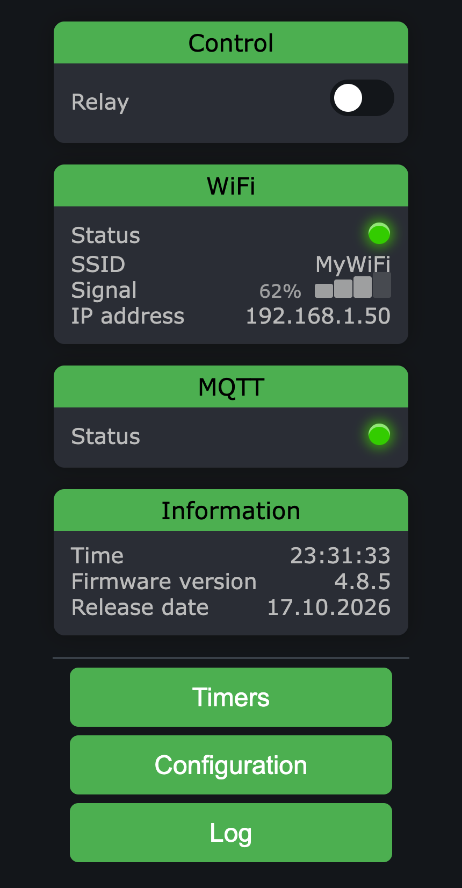
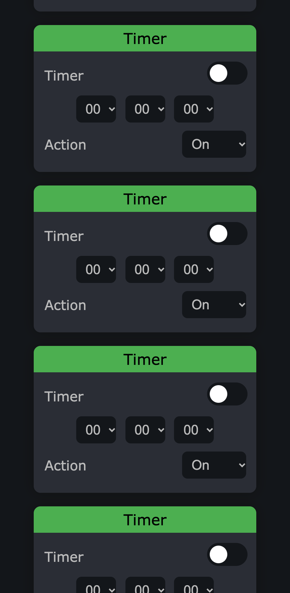
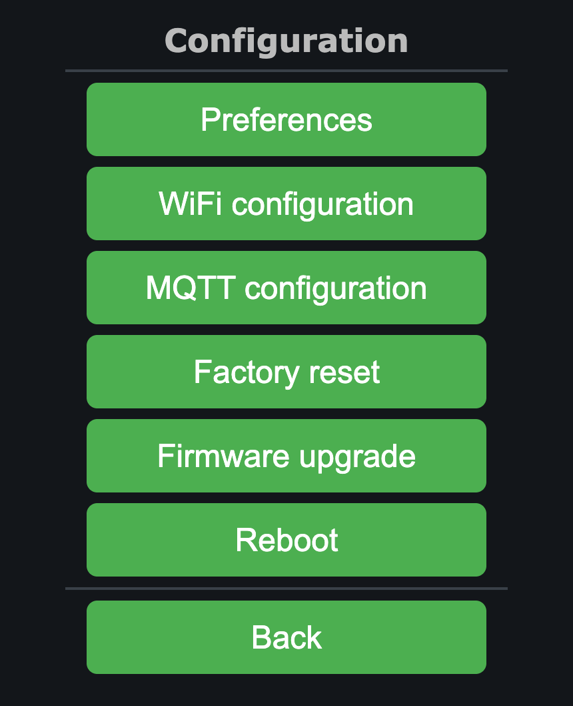
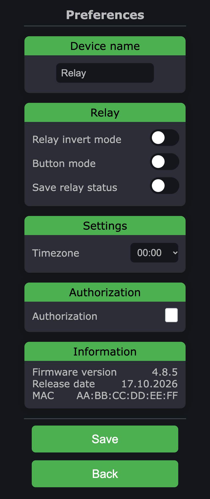
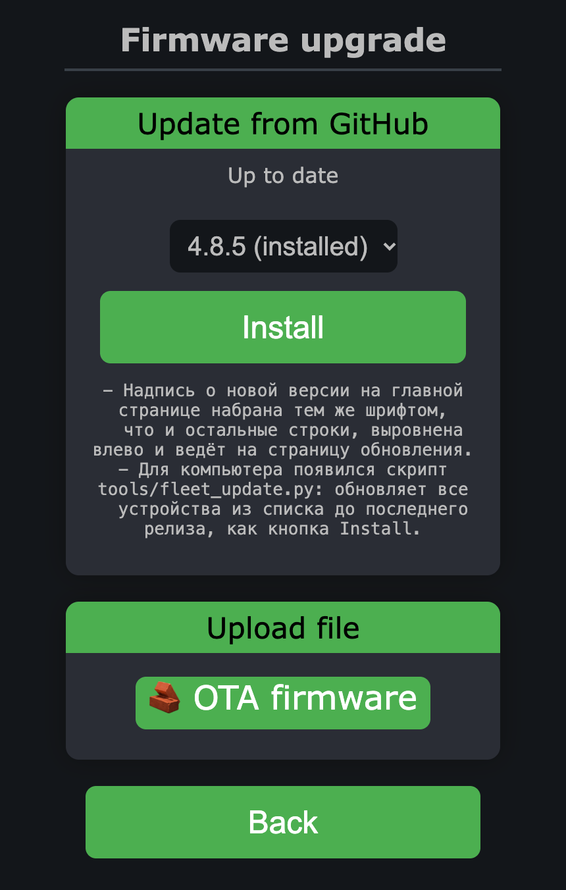

# ESP-Device-Portal

[](https://github.com/mr-whitefoot/ESP-Device-Portal/actions/workflows/ci.yml)
[](https://github.com/mr-whitefoot/ESP-Device-Portal/actions/workflows/release.yml)

Прошивка для ESP8266 на ESP-01/ESP-01s, Wemos/LOLIN D1 mini, ESP-07S и
Sonoff Basic R2 с web-порталом и интеграцией в HomeAssistant.

Одна кодовая база, три типа устройств: **одноканальное реле**, **банк из восьми
реле** и **датчик температуры DS18B20**. Конкретный образ выбирает и плату, и
тип устройства; ядро — портал, Wi-Fi, MQTT, настройки и OTA — у всех общее.

| Окружение       | Плата   | Устройство         | Пин             |
|-----------------|---------|--------------------|-----------------|
| `esp01_relay`   | ESP-01  | Реле               | GPIO0           |
| `d1_mini_relay` | D1 mini | Реле               | D1 (GPIO5)      |
| `esp07s_relay8` | ESP-07S | 8 реле             | 16,14,12,13,15,0,4,5 |
| `sonoff_basic_relay` | Sonoff Basic R2 | Реле  | GPIO12, кнопка GPIO0, светодиод GPIO13 |
| `esp01_ds18b20` | ESP-01  | Датчик температуры | GPIO2 (OneWire) |
| `d1_mini_ds18b20` | D1 mini | Датчик температуры | D2 (GPIO4, OneWire) |

Пять из шести образов проверены на живом железе: портал, MQTT и обновление по
воздуху работают на каждом. `sonoff_basic_relay` появился в 4.8.1 и пока
проверен только сборкой.

Номер версии общий для всех устройств — ядро одно, и правка в нём выходит сразу
для всех. Все изменения — в [CHANGELOG.md](CHANGELOG.md), а значения слов вроде
«образ» и «прошивка» — в [GLOSSARY.md](GLOSSARY.md). Репозиторий и его адреса
называются `ESP-Device-Portal`, локальный каталог с клоном может называться
иначе.


## Возможности

### Общее для всех устройств

- **Web-портал** для управления и настройки, без приложений и облаков.
- **MQTT** и интеграция с [HomeAssistant](https://www.home-assistant.io) через
  автообнаружение: discovery, состояние и доступность публикуются retained, а
  завещание (Last Will) переводит пропавшее устройство в `offline`. Одно
  физическое устройство может публиковать несколько сущностей — так работает
  банк из восьми реле.
- **Обновление по воздуху тремя путями**: кнопкой прямо в портале из свежего
  релиза на GitHub, файлом через страницу портала и через `espota` из
  PlatformIO.
- **Точка доступа при недоступном Wi-Fi.** Устройство поднимает свою сеть,
  чтобы его можно было перенастроить, и само возвращается в режим клиента,
  как только сеть появится — без перезагрузки. Короткое моргание связи ничего
  не запускает: сначала выжидается 10 секунд.
- **Поиск сетей на странице Wi-Fi.** Показываются три самые сильные сети,
  повторяющиеся SSID убираются, уровень сигнала виден столбиками, а нажатие
  переносит имя сети в форму. Сканирование асинхронное, поэтому портал и
  остальные задачи не замирают.
- **Опциональная авторизация портала.** Логин и пароль закрывают и портал, и
  страницу обновления прошивки. Сохранённый пароль обратно в форму не
  выводится.
- **Часы по NTP** с выбором часового пояса. Запрос и ответ разнесены во
  времени, поэтому неотвечающий сервер не останавливает устройство.
- **Настройки переживают обновление прошивки**: новый параметр получает
  значение по умолчанию, остальные не трогаются.
- **Лог с уровнями** — в Serial и на страницу `/log` портала, читается и
  глазами, и грепом:

  ```text
  [    0.043] I boot start Relay vX.Y.Z built=10.08.2026
  [    0.044] I boot chip=a1b2c3 heap=31240 flash=DOUT reset=External System
  [    2.117] I wifi connected ip=192.168.1.50 rssi=-61
  [    4.980] I ntp  synced time=12:04:33
  [ 1204.551] W dev  sensor read failed value=-127.0
  ```

  Отметка времени — аптайм: часы появляются только после NTP, а самое
  интересное происходит до него. Загрузочный баннер называет версию, дату
  сборки, chip ID, свободную кучу, режим флеша и причину сброса, а каждая
  перезагрузка объясняет свою причину. Паролей в логе нет — печатается только факт смены.
  Уровень отсекается при сборке: по умолчанию `INFO`, `-D LOG_LEVEL=4`
  добавляет отладочные строки, `-D LOG_LEVEL=2` оставляет предупреждения и
  ошибки и освобождает около 4,8 КБ флеша. Разбор формата — в
  [ARCHITECTURE.md](ARCHITECTURE.md#лог) и
  [ADR 0009](docs/adr/0009-levelled-device-log.md).
- **Ничего не блокирует главный цикл.** MQTT подключается асинхронно, и
  недоступный брокер не останавливает портал на время TCP-таймаута. Опрос
  датчика, синхронизация времени и попытки Wi-Fi разнесены во времени.
  Страницы, после сохранения которых устройство перезагружается, сначала
  отвечают браузеру и только потом уходят в перезагрузку.

### Реле

- Управление как высоким, так и низким уровнем сигнала — `Relay invert mode`.
- Импульсный `Button mode`: команда `ON` нажимает реле на 500 мс и отпускает
  само, без блокировки портала и MQTT. Повторная `ON` начинает отсчёт заново,
  `OFF` отпускает досрочно. На главной странице портала в этом режиме вместо
  переключателя показывается кнопка `Push` — защёлкивать нечего.
- Сохранение состояния реле при потере питания. В `Button mode` настройка
  скрыта: полусекундный импульс во флеш не пишется.
- Пять суточных таймеров на странице `Timers` с действиями «включить»,
  «выключить», «переключить». В `Button mode` выбор `Action` скрыт — таймер
  всегда даёт импульс `On`, а ранее выбранные действия сохраняются и
  возвращаются вместе с обычным режимом.
- **Кнопка на корпусе и светодиод** — там, где они есть на плате
  (`sonoff_basic_relay`). Короткое нажатие переключает реле, в `Button mode`
  даёт тот же импульс, что и команда `ON`. Удержание 10 секунд сбрасывает
  настройки к заводским: за три секунды до сброса светодиод начинает часто
  мигать, и кнопку ещё можно отпустить. Светодиод повторяет состояние реле.

### Банк из восьми реле

Те же режимы отдельно для каждого канала: своя подпись, инверсия, `Button mode`
и восстановление состояния. Home Assistant получает восемь независимых
switch-сущностей со стабильными идентификаторами `relay_1` … `relay_8`, общими
state и availability и отдельными command/discovery-топиками.

Пять таймеров общие для платы, и каждый содержит выбор целевого канала либо
пункт `All relays` — действие сразу для всех восьми.

### Датчик температуры DS18B20

- Один датчик на шине OneWire.
- Настраиваемый период опроса.
- Медианный фильтр показаний. Ошибки чтения и значения вне диапазона
  −55…125 °C отбрасываются и в HomeAssistant не попадают: пока достоверного
  значения нет, HA показывает `unknown` вместо выдуманного числа.


## Интерфейс web портала

Главный экран<br>


Поддержка таймеров<br>


Выбор настроек<br>


Настройки реле<br>


Обновление прошивки по Wi-Fi<br>



## Первоначальная настройка

- Подключиться к точке доступа устройства. Она называется по имени устройства
  плюс «AP»: `ESP Relay AP` у реле, `ESP Temperature AP` у датчика;
- Откроется портал; если не открылся — перейти по адресу 192.168.4.1;
- Нажать `Configuration`, затем `WiFi configuration`;
- Выбрать найденную сеть (SSID подставится в форму) и указать пароль. Скрытую
  сеть можно ввести вручную;
- Нажать `Save`.

Устройство попробует подключиться секундой позже, перезагрузка не нужна.
Секунда нужна, чтобы страница успела ответить: подключение переключает радио, и
без паузы ответ на сохранение терялся. При успехе статус Wi-Fi станет зелёным,
появятся имя сети (SSID), уровень сигнала и IP-адрес, а точка доступа отключится, как только вы
от неё отключитесь. Если данные не подошли, точка доступа останется поднятой и
их можно сразу исправить на той же странице.

Дальше подключитесь к своей сети и откройте портал по этому IP-адресу.

Повторные попытки подключения идут с нарастающими паузами: через 30 секунд,
минуту, дальше каждые три минуты. Отсчёт до следующей попытки виден на главной
странице портала. Пока на портале открыта страница, радио не переключается.

Если Wi-Fi пропадёт у уже настроенного устройства, оно выждет 10 секунд —
короткое моргание связи ничего не запускает — и попробует подключиться заново.
Точка доступа поднимется, только если и эта попытка не удалась; тогда
устройство снова можно перенастроить.

### Авторизация

В `Configuration` → `Preferences` включается `Authorization` с логином и
паролем. Поля появляются только при включённом чекбоксе; после сохранения
устройство перезагрузится, и портал вместе со страницей обновления прошивки
начнёт запрашивать эти данные.

Сохранённый пароль обратно в форму не выводится: пустое поле оставляет его без
изменений, пока логин не менялся. При смене логина нужно задать новый пароль —
иначе новый пользователь незаметно получил бы секрет прежнего.


## Обновление прошивки

### С GitHub прямо из портала

Устройство показывает, что вышло в релизах, и умеет обновиться само. Компьютера
с репозиторием не нужно: достаточно открыть портал с телефона или ноутбука, у
которого есть интернет.

- главная страница добавляет строку `New version X.Y.Z available`, если релиз
  свежее установленной прошивки, и молчит, если обновляться не на что. Строка
  является ссылкой на страницу обновления;
- `Configuration` → `Firmware upgrade` показывает результат проверки всегда:
  `Up to date`, номер новой версии или `GitHub unreachable`;
- рядом с кнопкой стоит выбор версии: свежая и четыре предыдущих релиза,
  своя помечена как `(installed)`. Это штатный путь отката — компьютер с
  репозиторием для него больше не нужен;
- под выбором выводится «что нового» для выбранной версии, тот же текст, что и
  в `CHANGELOG.md`;
- кнопка `Install` скачивает выбранный образ и отправляет его на устройство,
  показывая ход загрузки и прошивки. Дальше устройство перезагружается само.

Свой образ прошивка находит по имени: `Relay`, `Relay_D1_mini`,
`Relay_ESP07S_8ch`, `Relay_Sonoff_Basic`, `DS18B20`, `DS18B20_D1_mini`. Если в релизе нужного образа
нет или он не помещается в оставшийся флеш, страница скажет об этом до
скачивания.

Вместе с файлом на устройство уходят размер и md5 из манифеста, и устройство
сверяет принятые байты само. Это единственная сквозная проверка образа на пути
зеркало — браузер — устройство: посчитать хэш в браузере нельзя, портал
работает по http, а `crypto.subtle` доступен только в защищённом контексте. Не
сошёлся хэш — прошивка не применяется, устройство остаётся на прежней.

В интернет ходит браузер, а не устройство: HTTPS на ESP8266 стоит больше флеша,
чем осталось у ESP-01 и ESP-07S. По той же причине сам скрипт страницы лежит на
зеркале, а не в прошивке. Поэтому при подключении к точке доступа самого
устройства страница обновления скажет `Offline`, а ручная заливка файлом продолжит
работать. Разбор — в
[ADR 0012](docs/adr/0012-portal-github-update.md),
[ADR 0013](docs/adr/0013-own-firmware-upload-handler.md) и
[ADR 0015](docs/adr/0015-release-history-on-update-page.md).

### Всем парком с компьютера

`tools/fleet_update.py` делает то же, что кнопка `Install`, но с компьютера,
у которого есть HTTPS: берёт список устройств из `tools/fleet.ini`, читает
версию и образ с главной страницы каждого, сверяет их с последним релизом из
манифеста и отправляет `.bin.gz` с теми же проверками места и md5. Без
`--execute` печатает только план; датчики DS18B20 обновляются лишь с
`--allow-sensors`. После заливки ждёт, пока портал вернётся с новой версией
(`--verify-timeout`, по умолчанию 90 секунд). Устройства идут по очереди.

```
python3 tools/fleet_update.py                          # план для всех
python3 tools/fleet_update.py --device имя --execute   # обновить одно
python3 tools/fleet_update.py --inventory путь.ini     # другой инвентарь
python3 tools/fleet_update.py --self-test              # проверка логики
```

`имя` -- название секции в `tools/fleet.ini`, образец -- `tools/fleet.ini.example`.

### Файлом через портал

Путь для отката, непубликованных сборок и случая, когда у браузера нет доступа
в интернет.

1. Скачать [последний опубликованный релиз](https://github.com/mr-whitefoot/ESP-Device-Portal/releases/latest)
   либо собрать образ самостоятельно. Выбрать файл строго для своей платы и
   устройства: `ESP_Relay_...bin`, `ESP_Relay_D1_mini_...bin`,
   `ESP_Relay_ESP07S_8ch_...bin`, `ESP_Relay_Sonoff_Basic_...bin`,
   `ESP_DS18B20_...bin` или `ESP_DS18B20_D1_mini_...bin`. Образы разных плат взаимозаменять нельзя.
2. Открыть `Configuration` → `Firmware upgrade`.
3. Нажать `OTA firmware` и выбрать `.bin`. Именно несжатый: `.bin.gz` этот путь
   не принимает, потому что настоящий размер образа передать через форму
   нечем, а без него распаковка затрёт сама себя ([ADR
   0014](docs/adr/0014-compressed-ota-images.md)).
4. Дождаться `Update success`, после чего подождать не менее 25 секунд.
5. Вернуться на главную страницу и проверить версию в `Information`.

Опубликованный релиз может отставать от `release_version` в рабочей ветке.
Непубликованный образ при необходимости собирается из исходников нужного
коммита; для штатного обновления следует использовать файл из release.

### Из командной строки, espota

У ESP-01 нет USB, поэтому обычный способ обновления — espota на адрес
устройства:

```bash
pio run -e esp01_relay -t upload
```

Адреса устройств в конфигурации сборки репозитория не хранятся, поэтому команда
выше сработает только если адрес задан локально. Разово его можно передать
ключом:

```bash
pio run -e esp01_ds18b20 -t upload --upload-port 192.168.1.50
```

Чтобы не писать каждый раз, заведите рядом с `platformio.ini` файл
`platformio_override.ini` — он подключён через `extra_configs` и лежит
в `.gitignore`:

```ini
[env:esp01_relay]
upload_port = 192.168.1.40

[env:d1_mini_relay]
upload_protocol = espota
upload_port = 192.168.1.41

[env:esp07s_relay8]
upload_protocol = espota
upload_port = 192.168.1.42

[env:sonoff_basic_relay]
upload_protocol = espota
upload_port = 192.168.1.43

[env:esp01_ds18b20]
upload_port = 192.168.1.50

[env:d1_mini_ds18b20]
upload_protocol = espota
upload_port = 192.168.1.51
```

Файл необязательный: без него всё собирается, ругаться будет только `-t upload`.
Для D1 mini, ESP-07S и Sonoff Basic R2 по умолчанию выбран `esptool`: первую
прошивку можно залить по UART командой соответствующего окружения. У D1 mini
UART встроен:

```bash
pio run -e d1_mini_relay -t upload
```

Показанные выше `upload_protocol = espota` и `upload_port` переводят это
окружение на обновление по сети.

### Первая прошивка чистого модуля

Так залить нельзя ни один из способов выше: espota работает только с
устройством, где эта прошивка уже стоит. Чистый ESP-01 прошивается через
USB-UART переходник, GPIO0 на землю в момент подачи питания. Протокол задаётся
только в конфигурации — ключа командной строки для него нет, поэтому опишите
провод в том же `platformio_override.ini`, поверх espota:

```ini
[env:esp01_relay]
upload_protocol = esptool
upload_port = /dev/cu.usbserial-XXXX
upload_speed = 115200
```

и запускайте обычное `pio run -e esp01_relay -t upload`. После первой прошивки
строки можно убрать и вернуться к обновлению по воздуху.


## Подключение реле к D1 mini

- `D1` на плате D1 mini подключить к управляющему входу `IN` реле.
- `GND` D1 mini и `GND` модуля реле должны быть общими.
- Питание модуля подаётся по его спецификации; катушку на 5 В нельзя питать от
  вывода `3V3`.
- Управляющий вход модуля должен корректно распознавать логический уровень 3,3 В.

`D1` — это маркировка D1 mini для **GPIO5**. Это не GPIO1: переносить номер с
шёлкографии платы в `RELAY_PIN` как обычное число нельзя. Если реле активно
низким уровнем, после первого запуска включите `Relay invert mode` в
`Configuration` → `Preferences`.

## Подключение DS18B20 к D1 mini

- вывод данных DS18B20 подключить к `D2` (GPIO4);
- между `D2` и `3V3` установить подтягивающий резистор 4,7 кОм;
- питание датчика подключить к `3V3`, землю — к `GND`.

Окружение `d1_mini_ds18b20` задаёт этот пин явно как `ONE_WIRE_PIN=D2`.
До 4.4.0 шина была на D4/GPIO2 — это загрузочный пин ESP8266, и внешней шине
на нём делать нечего.


## Сборка

Нужен [PlatformIO](https://platformio.org) — расширение для VSCode либо `pio`
в командной строке. Зависимости он поставит сам при первой сборке.

```bash
pio run -e esp01_relay      # реле
pio run -e d1_mini_relay    # реле на D1 mini, пин D1
pio run -e esp07s_relay8    # восемь реле на ESP-07S
pio run -e sonoff_basic_relay  # реле Sonoff Basic R2, пин GPIO12
pio run -e esp01_ds18b20    # датчик температуры
pio run -e d1_mini_ds18b20  # датчик температуры на D1 mini, пин D2
```

Без `-e` собирается реле для ESP-01: именно `esp01_relay` указано в
`default_envs`. Готовые файлы ложатся в `.pio/build/<окружение>/`:

```
.pio/build/esp01_relay/ESP_Relay_v<версия>.bin
.pio/build/d1_mini_relay/ESP_Relay_D1_mini_v<версия>.bin
.pio/build/esp07s_relay8/ESP_Relay_ESP07S_8ch_v<версия>.bin
.pio/build/sonoff_basic_relay/ESP_Relay_Sonoff_Basic_v<версия>.bin
.pio/build/esp01_ds18b20/ESP_DS18B20_v<версия>.bin
.pio/build/d1_mini_ds18b20/ESP_DS18B20_D1_mini_v<версия>.bin
```

Рядом с каждым `.bin` появляется `.bin.gz` — тот же образ, сжатый gzip. По
воздуху через портал заливается именно он, поэтому сжимает сборка, а не
релизный workflow: локальный `pio run` должен давать ровно те же файлы, что и
релиз.

В конце сборки печатаются две строки вида (числа условные, настоящие -- в
выводе вашей сборки)

```
OTA headroom: <размер> of <предел> bytes used (<доля>%), <запас> left
gzip: <размер> bytes (<доля>%), unpacks to <размер> below staging at <адрес>
```

Первая — остаток до предела, за которым прошивка перестанет обновляться по
воздуху. Предел задаётся профилем платы: 479232 байта для ESP-01, релейной
платы ESP-07S и Sonoff Basic R2 с 1 МБ флеша, 1044464 байта для D1 mini с 4 МБ.

Вторая — размер сжатого образа и вторая граница безопасности: eboot
распаковывает от нуля вверх, а сжатый источник лежит в конце области скетчей,
и распакованный образ обязан кончиться раньше его начала. Конец области берётся
из того самого linker script, которым собран образ. При превышении любой из
двух границ сборка падает.

Версия платформы прикреплена (`espressif8266@4.2.1`). Без этого образы из CI
выходили на 3,3 КБ больше локальных при том же исходном коде, а на однометровых
платах такая разница — это разница между «влезает» и «нет». Обновлять её нужно
осознанно, вместе с пересчётом всех строк `OTA headroom`.

Образы ESP-01 собираются в режиме флеша `dout`, хотя манифест платы предлагает
`qio`. Под этим профилем в парке оказался не только настоящий ESP-01 с внешней
флеш-памятью, но и ESP8285 со встроенной, которой `qio` не подходит: прежний
SDK это терпел, а новый перестал, и устройство замерло на инициализации радио.
`dout` работает на обоих видах чипов ценой чуть более медленного чтения флеша.
Режим устройства виден в загрузочном баннере полем `flash=`; по воздуху он не
меняется никогда — `Updater` сохраняет режим работающей прошивки, поэтому
исправить его можно только заливкой по UART.

### Сборка в CI

То же самое повторяется на GitHub Actions при каждом push в `main` и на
каждый pull request: юнит-тесты плюс сборка шести релизных окружений и
диагностического `esp01_relay_metrics`. Строка `OTA headroom` каждого окружения
попадает в сводку прогона, а bin и elf — в артефакты, где лежат 30 дней.

Тег вида `version_X.Y.Z` дополнительно собирает прошивки заново и публикует их
в GitHub Release. В релиз идут обычные образы реле для всех четырёх плат и датчика
для ESP-01/D1 mini, каждый в двух видах — `.bin` и `.bin.gz`; диагностическая
сборка туда не попадает. Если версия в теге
не совпадает с `release_version` из `platformio.ini`, публикация падает, не
создав релиз.

Те же образы вместе с `manifest.json` и скриптом страницы `fw.js` уезжают на
GitHub Pages — это зеркало для страницы обновления в портале. Туда же
приносятся образы четырёх прошлых релизов: артефакт Pages заменяет сайт
целиком, так что история не накапливается сама. Глубину задаёт
`MIRROR_RELEASES`, и она равна ровно тому, насколько далеко можно откатиться
кнопкой. Ассеты релиза ей не годятся: они отдаются без
заголовка `Access-Control-Allow-Origin`, и браузер запрещает их читать со
страницы устройства. Форму записи образа в манифесте выбирает
`COMPRESSED_MANIFEST` в релизном workflow: в сжатой `file`, `size` и `md5`
описывают `.bin.gz`, а несжатый проходит полями `raw`, `raw_file`, `raw_md5`.

Сжатая форма включена с 4.7.1. Порог — 4.6.0: начиная с неё и скрипт, и
приёмник образа умеют gz, а прошивки 4.5.1 и старше берут из манифеста `file`
и отвергают `.bin.gz` своим же `not a .bin`. Развести две группы одним
манифестом нельзя — они читают одни и те же три поля, — поэтому устройство на
4.5.1 обновляется теперь только ручной заливкой `.bin` через портал.

Шаги публикации стоят в workflow после создания релиза, поэтому сломанное
зеркало не ломает выпуск прошивок.

Текст «что нового» для каждой версии берётся из `CHANGELOG.md`: секция с
заголовком-номером уходит и в тело релиза на GitHub, и в поле `notes`
манифеста, откуда его читает страница обновления. Забытую секцию релиз ловит до
сборки.

Зеркало требует двух настроек репозитория, которых нет в коде:

- Settings → Pages → Source = `GitHub Actions`. Сайт, заведённый из ветки,
  остаётся в режиме `legacy`, и `deploy-pages` отказывается разворачивать в него
  артефакт. В workflow стоит `enablement: true`, который переводит режим сам, но
  право на это у токена должно быть.
- Settings → Environments → `github-pages` → Deployment branches and tags:
  добавить правило для тегов `version_*`. По умолчанию окружение разрешает
  деплой только с ветки по умолчанию, а релиз идёт с тега, и публикация падает
  с `Tag "version_X.Y.Z" is not allowed to deploy to github-pages due to
  environment protection rules`.


## Тесты

Логика, не зависящая от железа, гоняется на хосте:

```bash
pio test -e native
```

Покрыты слой настроек, автоматы подключения к Wi-Fi и MQTT,
расписание таймеров, таблица часовых поясов, имена MQTT-топиков, разбор команд
MQTT, часы NTP, отложенная перезагрузка, управление реле, кнопка на корпусе,
светодиод состояния, разбор десятичных чисел и медианный фильтр датчика. Требуют железа и тестами не покрываются портал, сетевой транспорт
Wi-Fi/MQTT и файловая система; для них есть
[runbook проверки](docs/runbooks/verification.md).

Для того, что тестами не покрыть, рядом лежит наблюдатель MQTT — он показывает
флаг `retain`, которого не печатают обычные утилиты:

```bash
cp tools/broker.ini.example tools/broker.ini   # вписать адрес и пароль
python3 tools/mqtt_watch.py 'homeassistant/switch/ESP_Relay/#' 30
```

`ESP_Relay` здесь — имя устройства по умолчанию; если вы его меняли,
подставьте своё.

Зависимостей у него нет, протокол разобран вручную. `tools/broker.ini`
в `.gitignore` — в нём пароль от брокера.

Автоматический прогон сетевых проверок на одном реле делает
`tools/hw_test.py` (`python3 tools/hw_test.py --list` показывает проверки,
`--self-test` проверяет сам скрипт без устройства). Подробности и границы —
в [runbook проверки](docs/runbooks/verification.md), раздел 5a.


## Как выбирается устройство

Окружение задаёт плату, а также `-D DEVICE_RELAY`, `-D DEVICE_RELAY_BANK` либо
`-D DEVICE_DS18B20`. Для одноканального реле оно дополнительно задаёт
`RELAY_PIN`: на ESP-01 это `0`, на D1 mini — символьное `D1`, которое Arduino
core платы преобразует в GPIO5. Для датчика окружение задаёт `ONE_WIRE_PIN`:
GPIO2 на ESP-01 и символьное `D2` (то есть GPIO4) на D1 mini. Банк явно требует все
`RELAY1_PIN` … `RELAY8_PIN`. `src/main.cpp` по этому флагу подключает нужный
каталог `lib/device_*`. Сборка без флага падает с понятной ошибкой: молча
собранная не тем устройством прошивка уехала бы на железку и щёлкнула чем
попало.

```
lib/core/            портал, WiFi, MQTT, загрузка — общее для всех устройств
lib/settings/        слой хранения настроек поверх GyverDB
lib/device_relay/    реле: пин, инверсия, таймеры
lib/device_relay_bank/ восемь реле и таймеры с целевым каналом
lib/device_ds18b20/  датчик: опрос шины, фильтрация
lib/median_filter/   медианный фильтр, чистая логика
lib/decimal_parse/   разбор десятичных чисел для собственной atof (ADR 0019)
lib/button/          кнопка на корпусе: короткое нажатие и удержание
lib/status_led/      автомат светодиода состояния
lib/ntp_clock/       часы и автомат синхронизации, чистая логика
lib/mqtt_client/     асинхронный MQTT-адаптер и автомат переподключения
lib/mqtt_topics/     имена топиков и санация имени устройства
lib/timezone_table/  часовые пояса: подписи для портала и смещения
test/                тесты для pio test -e native, там же фейк Arduino
tools/               наблюдатель MQTT, fleet_update.py, hw_test.py, changelog.py
```

Новое устройство — это новый каталог `lib/device_*`, реализующий контракт из
`lib/core/core_contract.h`, и новое окружение в `platformio.ini`. Ядро при этом
не меняется.


## Документация разработчика

- [ARCHITECTURE.md](ARCHITECTURE.md) — устройство системы, границы модулей и
  инварианты совместимости;
- [журнал ADR](docs/adr/README.md) — почему приняты ключевые архитектурные
  решения;
- [runbook проверки](docs/runbooks/verification.md) — сборки, метрики и
  smoke-тесты на железе;
- [GLOSSARY.md](GLOSSARY.md) — что значат слова «образ», «прошивка», «зеркало»,
  «парк», `Button mode` и другие;
- [SECURITY.md](SECURITY.md) — модель безопасности и известные ограничения.


## История версий

Список изменений каждой версии — в [CHANGELOG.md](CHANGELOG.md): оттуда текст
уходит и в тело релиза, и на страницу обновления устройства.

Номер версии общий для всех устройств: ядро одно, и правка в нём выходит сразу
для всех прошивок ([ADR 0008](docs/adr/0008-shared-firmware-version.md)).


